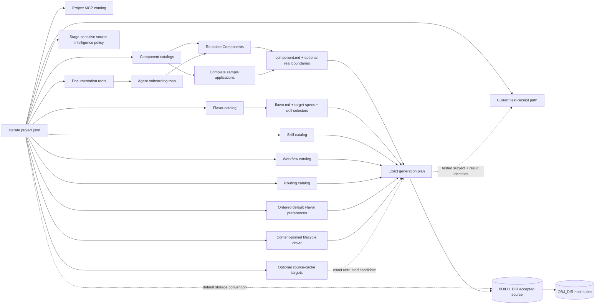

# Project layout

A Literate AI project declares its layout through its manifest and provider-neutral
onboarding skill. A derived 1.4 project keeps the application repository as its root
and places framework-owned authority and state in `litai/`:

```text
project/
├── README.md                   # application documentation
├── CHANGELOG.md                # application release history
├── source/                     # application source; native layout is preserved
├── AGENTS.md                   # optional owned delegate into litai/SKILL.md
└── litai/
    ├── literate.project.json   # exact catalog roots and structural profile
    ├── SKILL.md                # framework onboarding authority
    ├── literate.release.json   # optional framework release policy
    ├── components/             # framework-owned Component catalog
    ├── samples/                # full-profile starter application
    ├── flavors/
    ├── skills/
    ├── workflows/
    ├── routing/
    ├── docs/                   # framework documentation and roadmap
    ├── .literate/              # original provenance and migration history
    ├── generated/              # accepted-source cache
    ├── _build/                 # disposable framework build/runtime state
    └── verification/           # verifier contracts and durable passing receipts
```

This is the 1.4 development layout. Minimal native adoption creates a smaller
contained profile and preserves native build and release tools. Optional catalogs,
delegates and receipts appear only when their profile or owner creates them.
Existing 1.3.1/root-layout projects retain their declared paths until migrated;
the [migration section below](#derived-project-containment-and-migration) records
the supported phases and remaining qualification.

## Framework authoring and legacy root layouts

This repository authors the framework itself and retains the following root
layout. Existing root-layout projects may also declare these coordinates.
The lifecycle discussion uses logical framework-relative names; in a contained
derived project, use the actual `litai/` coordinates declared by its manifest.

```text
project/
├── literate.project.json       # exact catalog roots and structural profile
├── SKILL.md                    # provider-neutral agent onboarding
├── AGENTS.md                   # optional provider shim → SKILL.md
├── CLAUDE.md                   # optional provider shim → SKILL.md
├── agents/openai.yaml          # optional provider UI metadata
├── .cursor/rules/              # optional provider shim → SKILL.md
├── components/                 # reusable building-block Component catalog
├── samples/                    # complete demos; private except hello-component
├── flavors/                    # optional target-specific mixin catalog
├── skills/                     # optional conversion-skill catalog
│   ├── specification-to-source/# exact skills used during code generation
│   └── source-to-specification/# exact skills used for inverse authoring
├── workflows/                  # optional workflow.md stage-DAG/instruction catalog
├── routing/                    # optional model-eligibility catalog
├── mcps/                       # optional project-owned MCP servers (`mcp.md`)
├── docs/                       # required declared, linked narrative spine
│   └── architecture/
│       └── design-traceability.md # one authority-review marker
├── generated/                  # advisory BUILD_DIR; fungible accepted-source cache
├── _build/                     # advisory OBJ_DIR; disposable, ignored, never indexed
└── verification/
    ├── acceptance/             # verifier-only per-Component acceptance contracts
    └── current.json            # optional passing receipt; created after success
```

The taxonomy is a small authority graph, not a set of folders tools search by guesswork:



A Component owns what the application must do. Selected Flavors add target-specific
requirements, skills guide the conversion, workflows order the stages, and routing
limits eligible models. Only catalogs named by the manifest can contribute to that
plan. Optional `mcp_roots` hold project-owned MCP servers (`mcps/<id>/mcp.md`); see
[ADR 0024](../decisions/0024-project-mcp-catalog-hygiene.md). Operator MCP opt-in lives
under the platform-resolved `literate-ai` user configuration root, not in git. On
Linux/macOS that defaults to `$HOME/.config/literate-ai`. An interactive session follows
`skills/agent/configure-operator-mcp/SKILL.md` to discover connected MCPs and
write that catalog
([ADR 0021](../decisions/0021-operator-local-mcp-catalog.md),
[ADR 0022](../decisions/0022-channel-author-recipient-vocabulary.md),
[ADR 0023](../decisions/0023-mutagenic-cli-channel-fan-out.md)).

When a selected Flavor declares `requires`, its Component providers join the same exact
project DAG as Component-authored dependencies. The closure is recursive and
selected-only: choosing the Flavor adds its typed phase edge and provider; omitting the
Flavor omits both. This is the intended way for a derived project to add a packaging,
deployment, accelerator, or other target-specific capability without patching its base
Component or installing a runtime plugin.

Documentation is first-class project state, but it does not silently become application
behavioral authority. Prose in a Component specification remains normative; the
declared narrative spine explains how that authority fits together, while nearby
Mermaid diagrams make its behavior, boundaries, and examples legible in the
literate-programming tradition.

Run `litai project validate` from anywhere below the root. The command discovers
`literate.project.json`, requires the declared root `SKILL.md`, checks every declared
catalog boundary, validates each provider shim that is present, checks the configured
source-intelligence evidence without mutation, and requires a supported runtime, regular non-symlink
database, exact project-root binding, and zero pending/worktree drift. It then validates
Components and Flavors, verifies all content pins, checks exact skill dependencies and
cycles in the forward and inverse catalogs, enumerates every declared Markdown document
with a content identity, and rejects retained generated Component source. `SKILL.md`
must link into declared documentation; a local link to an undeclared ambient document
fails validation. Exactly one declared document must contain a current
`literate-ai:authority-reviewed` marker bound to the whole authority and documentation
graph. If `test_receipt` is configured, validation also reports whether its admission
policy is absent, its file is missing, or its receipt is current, stale, or mismatched.
A `policy-unconfigured` scaffold is valid for onboarding; it is not authority to accept
or claim a passing run.

The manifest's `source_intelligence` object is configuration authority. Default
init selects provider `none` with every stage `off`.

## Derived-project containment and migration

The 1.4 layout requirement puts framework-owned derived-project authority and
state under `litai/`. The application root remains the base for project-relative
paths. Its source, package metadata, native build and CI, changelog and product
documentation retain their application coordinates. The framework repository
continues to use its own authoring layout. The accepted contract and remaining
qualification are tracked by
[PROJECT-LAYOUT-001](../roadmap/active-work.md#project-layout-001-contain-derived-project-literate-ai-files-under-litai)
and [ADR 0071](../decisions/0071-derived-project-litai-directory.md).

A contained project's manifest is `litai/literate.project.json`. Its declared
catalogs, onboarding skill, framework documentation, locks and durable receipts
belong to that same framework directory. Contained release output defaults use
`litai/_build/release/`. A project-relative application path still resolves from
the application root; declaring a framework directory does not rebase it.

Retained-child repository lifecycle execution keeps its logs, execution lock and
receipts under `litai/_build/lifecycle/` for a contained project. Child command
working directories and native products keep their original child coordinates.
Reviewed lifecycle plans bind the exact selected project manifest; moving or
changing that authority requires a new plan, including before resuming a run.

Worker-receiver default generated/object caches also use the transported project
context, including `litai/generated/` and `litai/_build/` for contained projects.
They ignore ambient coordinator cache overrides. Explicitly supplied attempt
custody and accepted-source-cache staging keep their original bindings. Separate
receiver runtime and candidate-receipt containment remains unfinished.

For a contained project, an implicit Standard rebuild runtime is a fresh private
attempt beneath `litai/_build/`. Use `--keep-runtime` to retain that attempt for
inspection. The live attempt excludes object-cache cleanup while it runs; its
cleanup preserves unrelated session state and refuses a replaced directory.
Default contained build/test receivers use separate runtime, candidate-receipt
and object-output slots beneath `litai/_build/`. Object evidence comes from that
invocation's object directory. Source verification precedes allocation, and live
write controls are excluded from transported evidence. A conflicting runtime is
preserved for inspection. Explicit short accepted-cache staging, general
external-driver containment and full transfer/recovery qualification remain open.

Historical native-child audits use a fresh private view for each recorded manifest
candidate under the parent's contained object state. The original inspection owner
checks project context and native manifest identity while retaining the runtime or
cache lock. Audit views use private file/directory modes and leave the live child's
bytes and modes untouched. Unknown files or replaced postimages are preserved;
cleanup refusal cannot advance to another historical candidate. On a closing
conflict, CLI errors retain the original code and show the original project-relative
scratch coordinate before the verifier message. The coordinate is diagnostic;
directory movement or replacement may invalidate it, and it grants no cleanup
permission.

Contained CodeGraph status checks place their source and SQLite snapshots under
`litai/_build/`. They reuse the current project runtime when one is active;
standalone checks hold the project cache lifecycle lock. The original staging
owner disposes only its recorded native postimages. Unknown provider/private
output or replaced files are retained and reported, including when status fails.
Legacy framework-authoring status retains its existing temporary placement.

Project-aware source caches reserve the configured intelligence database and its
finite provider controls. For contained CodeGraph projects this includes
`litai/codegraph.db`, its SQLite sidecars and lock/log/control files. Cache targets
and materialized source cannot occupy these names or portable aliases. Unsafe
ancestor aliases refuse without following their targets; ordinary generated
sources under `litai/generated/` remain supported. Materialization does not renew
current acceptance or qualify the intelligence provider.

Native-child promotion, registered lifecycle rebind and replacement retain their
registry, locks and history under the declared framework directory. In a contained
parent these live under `litai/.literate/`; application-root metadata stays with the
application. Selecting the parent's `litai/` coordinate keeps child/source paths
relative to the application root. Contained rebind/replacement review plans use
version 2 and refuse changed native namespaces. Historical records remain evidence
of the original transition and do not qualify the current child. Full migration,
temporary-file cleanup and installed/platform qualification remain open.

Repository orchestration locks follow the selected project context. Contained
projects keep the repository lock and its writer marker under `litai/.literate/`;
application-root `.literate/` content stays untouched. The application root and its
declared `litai/` coordinate select the same repository. Lock checks report the
contained path using `repository-lock-check@2`; legacy projects retain version 1.
A changed layout, replaced framework directory or dual authority requires a fresh
observation rather than reusing the existing lock store.

Remote accepted-source-cache restoration requires a fresh destination. Existing
files, directories and aliases are preserved; an aliased build parent refuses
before extraction. Complete short-cache placement and disposal qualification
remain open.

Evidence copying checks names and native file identities before payload reads,
streams within the existing file/byte quotas, and verifies the copied bytes.
Aliases and portable-name collisions refuse; hardlink paths are charged separately.
Archive writing consumes the same native namespace controls and checks streamed
bytes against the captured evidence ledger. Deterministic tar/gzip formatting is
retained. Unique temporary outputs are verified before atomic publication that
refuses existing final names; failed partials remain for owned recovery. Native
hardlink support is required and unsupported publication fails closed. Deferred
cleanup now joins the exact acknowledged manifest to an evidence-ledger intent and
original native journal/root identities. POSIX source controls retire captured
entries in a private slot and retain the empty original directory as a recovery
anchor. Added/replaced entries and legacy path-only tickets refuse. Repeated ACKs
revalidate original emptiness. Windows entry/ticket disposal now uses verified
native handles and extended disposition without changing readonly hardlink peers.
Unsupported operations preserve recovery state. This implementation has local API
model coverage. Producer metadata queries coexist with original live control writers
without granting payload reads; mutation and changed native identities refuse.
Actual native Windows acceptance remains unproven.

Evidence staging now retains the original native parent/root and creator-file
custody through copy, archive publication and disposal. Unknown entries or changed
native identities preserve the stage instead of sweeping its pathname. A secondary
disposal refusal does not replace the original failure. Default contained receivers
place staging beneath the original reserved `litai/_build/` parent, separate from
copied runtime and object outputs. Local source and Windows API-model controls
exercise these joins. RUN, legacy/opaque and explicit short-cache placement,
immediate cleanup and full installed/supported-platform qualification remain open.

Eligible root agent integrations are the finite `AGENTS.md`, `CLAUDE.md`,
`.cursor/rules/literate-ai.mdc` and `agents/openai.yaml` inventory. Their owned
content delegates into the configured onboarding skill. Custom instructions and
application-owned sections remain with their owners. Root ignore rules and native
build entrypoints retain their explicitly owned integration regions.

Inspect the current ownership and unresolved transitions first:

```console
litai --json project layout plan --project .
```

An incomplete inventory returns exit status 1 with an `ok: true` result envelope
and `planning_complete: false`. Root and descendant paths select the same project.
Inventory classifications describe the work required; an acknowledged migration
plan separately selects exact files and reference edits.

For an eligible legacy converted project, request its migration plan with
`project layout plan --migration`. Review `blocked_references`, then repeat the
plan with one `--rewrite-reference PATH` per authorized document. Apply with
`project layout apply --acknowledge --plan-identity ID`, repeating the same scope
and reference options. The ID must be copied from that exact reviewed plan.

After metadata placement, an existing contained generated project, including a
converted project, can request its imported-catalog continuation with
`project layout plan --migration --place-imported-catalogs`. Apply that exact plan
using `project layout apply --place-imported-catalogs` and the acknowledgement,
identity and reviewed reference options. This phase preserves imported source
identities, original application files, Git state and earlier migration journals.
Unresolved ownership and unsupported reference transformations remain visible.

Component placement preserves its original lock/audit bytes as history; ordinary
producer currentness and any required renewal remain separate. When catalog
placement is followed by framework-authority placement, undo the framework phase
before recovering the earlier catalog phase so each journal sees its own exact
metadata state.

Catalog apply and recovery return
`literate-ai/project-layout-catalog-continuation-result@1`. The original read-only
plan remains unchanged under `plan`; `applied` or `rolled_back` reports the file
transaction. `qualification` and `full_containment` remain false. Recovery uses
`project layout recover --acknowledge --plan-identity ID`; it restores exact owned
states and preserves concurrent changes. `retained_scaffolding` identifies
coordination directories deliberately retained after rollback.

Existing contained generated projects can plan original framework-owned
instructions and catalogs, including the seven conversion-wrapper outputs, with
`project layout plan --migration --place-framework-authority`. Review
`required_owners`; unresolved ownership keeps `applicable` false. This scope is
separate from imported-catalog, forward-Skill, release-policy and explicit
reference-edit scopes. It does not adopt imported or custom authority.

Apply with `project layout apply --place-framework-authority --acknowledge
--plan-identity ID --project PATH`. Recover the exact journal with
`project layout recover --place-framework-authority --acknowledge
--plan-identity ID --project ROOT`; recovery uses the original project root even
if publication interrupted the manifest. Both return
`literate-ai/project-layout-framework-authority-result@1`, with their original
read-only plan under `plan`. Original normal producer currentness and required
renewal remain separate; these transactions do not claim full containment or
qualification. Retained application implementation stays at its native path.

Renew a selected original producer after placement with
`litai project layout renew --place-framework-authority --acknowledge
--plan-identity ID --project PATH --component litai/components/NAME
--target TARGET`. The Component coordinate is relative to the application root;
`PATH` may name that root or a descendant. The original native journal determines
which Component and target are eligible before normal planning starts. Supply
ordinary `--flavor SELECTOR` and project-relative `--flavor-root DIRECTORY` options
when selecting local policy; omitted roots use the project's declared catalogs.
The command obtains a fresh normal preparation and current Root owner rather
than restoring a retired source actor.

The result is `literate-ai/project-layout-framework-producer-result@1`.
`current` reports the normal producer check; `writes` distinguishes an unchanged
pair from actual lock/audit renewal. The journal retains original native history
for exact rollback. `finalized`, `full_containment` and `qualification` remain
false. Other path-bound evidence still requires its own normal producer.

For an inherited Component placed by the catalog scope, use
`litai project layout renew --place-imported-catalogs --acknowledge
--plan-identity CATALOG_ID --project PATH --component litai/components/NAME
--target TARGET`. If framework-authority placement followed catalog placement,
include `--successor-plan-identity FRAMEWORK_ID` from that exact original plan.
Ordinary `--flavor` and project-relative `--flavor-root` options select policy.
The result is `literate-ai/project-layout-catalog-producer-result@1`; the retained
catalog intent identity describes native history and does not grant ownership.

After normal producers are current, close their old source namespaces with
`litai project layout finalize --place-framework-authority --acknowledge
--plan-identity FRAMEWORK_ID --project PATH`, followed by
`litai project layout finalize --place-imported-catalogs --acknowledge
--plan-identity CATALOG_ID --successor-plan-identity FRAMEWORK_ID --project PATH`.
Omit the successor option when no framework successor was applied. Root and
existing descendant paths discover the same project. Each scope remains separate;
finalization preserves retained application implementation and concurrent files.
Unknown source residuals block retirement without authorizing their removal.

Both commands return `literate-ai/project-layout-source-finalization-result@1`.
`components_finalized` describes only the original selected Components;
`full_containment` and `qualification` remain false. Repeat finalization is
idempotent. Original recovery still runs in reverse placement order and restores
only still-owned exact native states. Source finalization currently refuses on
Windows; supported-platform acceptance remains open for this in-progress work.

Path-bound evidence requires its ordinary producer's currentness check and any
necessary renewal. Historical records remain historical. Fresh creation, complete
existing-project placement and installed Linux/macOS/Windows acceptance remain
open until every PROJECT-LAYOUT-001 evidence item passes.

## Framework origin and project updates

`litai init` creates and validates the canonical scaffold, initial Component locks,
Standard lifecycle binding, default-off source-intelligence policy, authority-review marker, exact
`.literate/initialization-origin.json`, and a content-addressed
`.literate/initialization-baseline.json`.

A safe framework update cannot compare a project with whichever `litai` happens to be
on `PATH`. The planned `UX-275` contract records the repository from which the installed
distribution originated—including an operator fork—plus its exact Git revision,
framework/template protocol, and a content-addressed manifest of initialized files.
Built wheels retain that URL/revision in a generated package resource rather than
depending on the installer-local `direct_url.json`, which ordinarily names only the
wheel file. The release gate installs the wheel outside every checkout, initializes a
project, and requires the recorded origin to equal the build checkout exactly.
`framework_distribution_identity` identifies the exact logical payload of the built and
installed wheel, including that embedded origin resource; it is not a synonym for the
Git commit. The identity observed from the exact wheel artifact being distributed is
authoritative. Repeated clean builds are comparable only when revision and canonical
build-origin inputs are also identical, and `make wheel-check` verifies that such builds
produce the same logical payload identity even when archive container metadata differs.
`litai init --from URL[#REVISION]` records an authored direct-parent selection plus a
complete ancestor-first lock in `.literate/repository-lineage.json`. It materializes
regular tracked Component, Flavor, skill, workflow, and routing files with exact
provenance in `.literate/imports.json`; it never checks parent code out or executes it.
Workflow and routing documents are inherited as independently named catalog items so
Component-global generation references remain resolvable. Descendants override
ancestors, while incomparable definitions of the same catalog coordinate are rejected.
See [repository inheritance](../architecture/repository-inheritance.md).

`litai update [PROJECT]` verifies initialization evidence, re-resolves the complete
parent chain, and emits versioned three-way plans for both inherited catalogs and the
static framework scaffold: `unchanged`, `already-current`, `upstream-only`,
`local-only`, `mergeable`, `conflict`, `upstream-added`, or `preserved-dynamic`. `--apply` updates
upstream-only files, clean text merges, and the exact lineage/provenance records.
Local overlays survive merging; overlapping conflicts require explicit review.
`.literate/update-bases.json` retains verified upstream bases across updates;
`--resolutions FILE` explicitly applies identity-bound reviewed conflict choices. `--adopt-added` remains an explicit capability-adoption
decision. After review, repeatable `--take-upstream PATH` choices can include exact
inherited-catalog conflicts in that same transaction; other paths fail before writes.
A repeatable `--keep-local PATH` can retain an exact planned removal when local
authority still depends on it. Validation failure rolls inherited files, provenance,
and lineage back.

`litai reparent URL[#REVISION]` resolves and reviews a new complete chain before a
compare-and-swap change. `litai reparent none` explicitly makes the repository a root;
for that project, `litai update` is a no-op. Lock refresh,
tests and receipt finalization remain subsequent gates.

Each catalog-root field remains explicit in the manifest, but unused Component, Flavor,
skill, workflow, and routing lists may be empty. `documentation_roots` is required and
non-empty because the project must retain an obvious onboarding path. Every listed root
must be an existing directory inside the project. This lets a narrowly scoped project
avoid manufacturing unused catalogs while keeping its narrative discoverable.

`test_receipt` is different from a catalog root. It is an optional normalized relative
file path outside every catalog, `SKILL.md`, and `literate.project.json`. The canonical
initializer sets it to `verification/current.json` but does not invent a receipt. Only
an exact passing test result admitted by `test_receipt_policy` may create or replace
that file. The policy pins the suite ID/version, exact runner identity, required
evidence kinds, and minimum passing-test count. Without it, no receipt is current.

`default_flavor_selectors` is also optional. It is an ordered list of `+flavor` and
`-flavor` preference operations applied only when a Component declares the Flavor's
axis; explicit request selectors run afterward. This repository and every initialized
project record `+flavor://literate-ai/build-bazel` and include the exact pinned
Flavor/specification and build
skill. An explicit alternative or `-bazel` wins before prompt assembly. Components
without a `build.system` slot—including the current samples—remain unchanged, and a
selected preference is not evidence of the build system that actually ran.

`lifecycle_driver` is the explicit project TCB used by `litai rebuild`. It binds sorted
implementation paths and their aggregate content identity, one shell-free command
template, the allowed environment-key subset, timeout, specification scope, and complete
phase order. Project validation admits that declaration; rebuild verifies those files,
the resolved executable, expanded command, and project revision before and after the
host lifecycle.

`source_cache` is optional derived-state policy. It can name project-relative roots
that do not overlap any authority/onboarding/receipt path and operator-bound roots whose
absolute paths are supplied at runtime. A Git repository or monorepo may track a
declared project-relative immutable cache layout. That does not make its source entries
authority: every cache hit remains acceptance-untrusted until the current lifecycle
rebuilds and independently verifies it.

## Documentation is a reviewed project graph

Every Markdown file and local asset beneath `documentation_roots` is declared project
content. Local links must resolve without symlinks or path escapes, fragment anchors
must exist, remote images are rejected, every declared document must be reachable from
the root `SKILL.md`, and every declared asset must be referenced. Ambient Markdown
outside those roots does not join the graph.

Standard `.pyc` and `.pyo` bytecode beneath a `__pycache__` directory, including
CPython numeric temporary suffixes during atomic writes, is generated cache data
and does not join documentation authority. Explicit links to those cache files
are rejected; link to the authored source instead. Other files in a cache
directory and bytecode outside it remain ordinary assets. Traversal, symlink,
path and entry-count limits still apply to cache entries. Native Windows
qualification redirects child bytecode to its own retained run directory.

One marker records that a human reviewed the current narrative against the current
authority graph. Its digest covers the project definition, onboarding skill,
Components, Flavors, exact forward and inverse skills, workflow/routing catalogs,
normalized declared Markdown, and declared assets, excluding the tactical execution
queue under `docs/roadmap/`. Graph validation still admits those queue files so broken
links fail closed; checkbox churn does not stale the marker. Any other relevant change
makes it stale.
Run `litai project documentation-update .` first for a deterministic, non-writing drift
plan. An explicitly authorized `--apply --allow-model-egress` run can propose and apply
only validated replacements for existing declared Markdown; it never records review.
After inspecting the diff, run `litai project documentation-review . --record` to write
the exact marker and validate again. This keeps documentation changes explicit and
reviewable without pretending a hash or model can judge the quality of the explanation.

## Authority follows the catalog, not the directory name

The full paths above are the canonical defaults created by `litai init`, not a
minimum-validity checklist. Tools read their actual roots from
`literate.project.json`; they do not search arbitrary parents for a directory that
happens to be named `_shared`. References may cross catalog directories only inside the
explicit project root and only when their SHA-256 identity matches.

Containment and identity are necessary but not sufficient admission checks. A Component
or Flavor can use a specification-to-source skill only when the exact `SKILL.md` file
is enumerated beneath one of the declared `skill_roots`. An identical, correctly pinned
file elsewhere inside the project is ambient content and validation rejects it. An
undeclared directory named `skills/` has no authority, while a differently named root
listed in the manifest does. This keeps the manifest's catalog graph—not filesystem
proximity or a matching digest—the single source of admission authority.

The same rule governs inverse authoring: descriptor-based source-to-specification cases
load the union of `source-to-specification/` manifests under declared `skill_roots`,
including differently named and multiple roots. They never climb parent directories in
search of a conventional `skills/` directory. An explicit `--skills-root` remains an
operator-selected catalog; arbitrary-source analysis additionally requires exact
reviewed built-in identities.

A Component normally keeps all authored metadata and behavior in its own
`component.md`. That single-file default makes ownership obvious without manufacturing
an `openspec/` directory, JSON projection, and acceptance directory for a small unit.
Add another specification file only for a named domain/module boundary and add an
`interfaces/` document only when another independently generated Component consumes the
public contract. Generated `component.lock.json` records exact resolution beside the
authoring document; it is not maintained as prose or copied into `component.md`.

Repository conformance selection, fixed invocation vectors, and private oracle values
are test infrastructure, not Component prose. Keep them in a separately declared test
or harness area and bind them to the exact Component/specification identity; never place
private oracle content in the model-visible Component tree. Shared OS and language rules
belong in `flavors/`. Conversion technique belongs in `skills/`. Stage order belongs in
`workflows/`, and model eligibility belongs in `routing/`. This framework repository
declares both `components/` and `samples/` as Component roots for resolution, but their
roles are not interchangeable: `components/` contains reusable providers and `samples/`
contains complete demo compositions. Samples remain private downstream except for the
explicitly inheritable hello starter; `litai init` uses `components/` for ordinary
projects.

## Generated source and generated tests are outside the project

Tracked source under a forward-generation Component would bypass the workflow this
layout exists to test. Generate into a new, empty directory outside the project:

```console
litai lock samples/hello-component --target macos-host --flavor=+flavor://literate-ai/os-macos --flavor=+flavor://literate-ai/lang-python
litai plan samples/hello-component --target macos-host --flavor=+flavor://literate-ai/os-macos --flavor=+flavor://literate-ai/lang-python
litai generate samples/hello-component \
  --output /tmp/hello-component \
  --target macos-host \
  --flavor=+flavor://literate-ai/os-macos \
  --flavor=+flavor://literate-ai/lang-python
```

Build products, accepted workspaces, and runtime state stay outside project authority.
Direct generated application output can never target the project as a second source of
truth. `BUILD_DIR` (default `generated/`) and `_build` (`OBJ_DIR`) are the advisory
default prefixes for that fungible product source and its disposable objects; they are
not mandatory for load-bearing project authority. A coding CLI writing a root Makefile
as generated application output remains wrong; writing or updating the project's
Makefile as project authority is allowed. A source cache may live in a
declared project-relative derived-data path or an operator-bound external path, but it
cannot overlap `components/`, `flavors/`, skills, documentation, or another authority
root. Bazel output/action caches follow the selected build integration's own declared
derived-state policy.
Each clean major rebuild creates this external shape:

```text
generated-output/
├── source/                     # disposable generated source tree
│   ├── .literate/
│   │   └── sbom.cdx.json       # strict CycloneDX 1.7 pre-build SBOM
│   └── tests/manifest.json     # current generated implementation tests
```

The implementation, suite, and source SBOM are derived from the current specs, selected
Flavors, exact skills, and managed dependency projection, then discarded with that
generated tree. Both source and resolved SBOMs bind the same exact
`ComponentComposition` identity and contain its complete managed graph: the root, every
transitive Component, every declared repository-source dependency, and every
relationship's source, target, kind, optionality, and identity. The resolved
post-build CycloneDX SBOM is separate external evidence because it binds and preserves
the exact source SBOM while adding the package, toolchain, runtime, and binary closure
actually observed after build and before tests.

The one exception is not generated source: `verification/current.json` is a small,
canonical passing-only receipt bound to the complete current authority-review identity.
A test adapter creates a candidate outside the project; the receipt command atomically
replaces the configured file, and a user or CI commits that one file. Git provides the
history. Test logs, generated tests, binaries, host paths, and failed or skipped
receipts remain outside the repository.

Source under a source-to-specification fixture is an analysis input, not generated
Component output, and is therefore a separate taxonomy.

## Create a project

`litai init PATH` intentionally creates the complete canonical taxonomy plus the
root onboarding skill, thin Codex, Claude, Cursor, and generic agent entrypoints (the
generic `AGENTS.md` is also consumed by OpenCode), and the
pinned `bazel` Flavor/specification with its exact build skill. Its manifest selects
`+flavor://literate-ai/build-bazel` as a removable generation-prompt preference, not
runtime enforcement. Those
defaults provide an obvious starting point, while hand-authored manifests may leave
unused catalog lists empty and omit every provider shim. Initialization creates no
generated application source and no synthetic passing receipt. Add only the catalogs the
project needs, then keep `litai project validate` green.
